# 🏠 Global Student Accommodation Analytics

An end-to-end **Data Analytics Project** focused on analyzing student accommodation enquiries, bookings, revenue, payments, reviews, and customer support using Python.

The project explores business trends across seven datasets to identify student preferences, booking patterns, revenue performance, and opportunities for business improvement.

---

## 📌 Project Overview

Student accommodation businesses receive enquiries from students searching for housing in different countries and destinations. Understanding student preferences, booking behavior, revenue trends, and customer satisfaction is essential for improving business performance.

In this project, I analyzed seven interconnected datasets using Python libraries to perform data cleaning, exploratory data analysis (EDA), business metric calculations, and data visualization.

## 🎯 Business Objectives

- Analyze student enquiries by origin country.
- Identify the most preferred accommodation destinations.
- Understand booking trends across different property types.
- Analyze monthly booking and revenue trends.
- Evaluate booking status and cancellation patterns.
- Identify revenue contribution by destination country.
- Analyze payment status and student satisfaction.
- Generate meaningful business insights and recommendations.

## 🛠️ Tools & Technologies

| Technology | Purpose |
|---|---|
| Python | Data analysis and programming |
| Pandas | Data manipulation and cleaning |
| NumPy | Numerical operations |
| Matplotlib | Data visualization |
| Seaborn | Statistical visualization |
| Jupyter Notebook / Google Colab | Development environment |

## 📂 Datasets

The project uses seven CSV datasets:

| Dataset | Description |
|---|---|
| Students | Student information, origin country, and destination preferences |
| Properties | Accommodation details and property types |
| Enquiries | Student accommodation enquiry records |
| Bookings | Booking details, dates, and booking status |
| Payments | Payment transactions and payment status |
| Reviews | Student feedback and ratings |
| Support Tickets | Customer support records |

## 🔍 Project Workflow

1. **Data Loading:** Imported all seven datasets using Pandas.
2. **Data Inspection:** Examined dataset dimensions, columns, data types, and sample records.
3. **Data Quality Analysis:** Identified missing values, duplicate records, and blank strings.
4. **Data Cleaning:** Handled blank values and converted date columns into appropriate datetime formats.
5. **Exploratory Data Analysis:** Explored student demand, destination preferences, bookings, revenue, cancellations, payments, and reviews.
6. **Business Metrics:** Calculated average booking value and bookings-to-enquiries ratio.
7. **Data Visualization:** Created charts to identify trends, patterns, and business opportunities.

---

## 📊 Data Analysis & Visualizations

### 1. Student Enquiries by Origin Country

Analyzed the number of accommodation enquiries received from different countries.

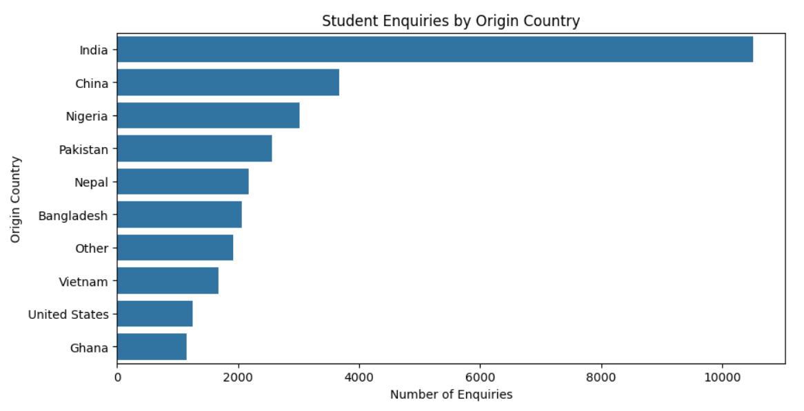

**Insight:** India generates the highest number of student enquiries, followed by China and Nigeria.

### 2. Student Preferred Destinations

Identified the most preferred destination countries among students.

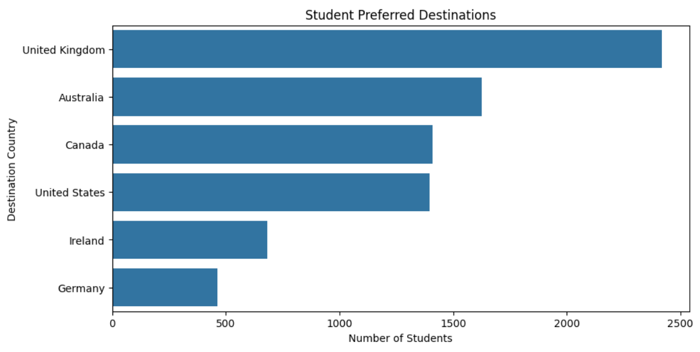

**Insight:** The United Kingdom is the most preferred destination, followed by Australia.

### 3. Bookings by Property Type

Compared booking volumes across different accommodation types.

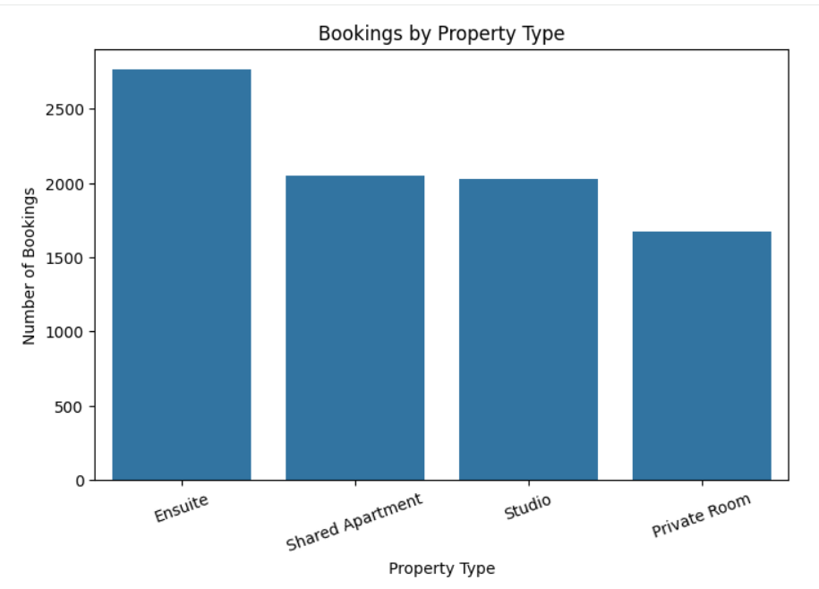

**Insight:** Ensuite accommodation has the highest number of bookings among the property types analyzed.

### 4. Monthly Booking Trends

Analyzed booking patterns across different months.

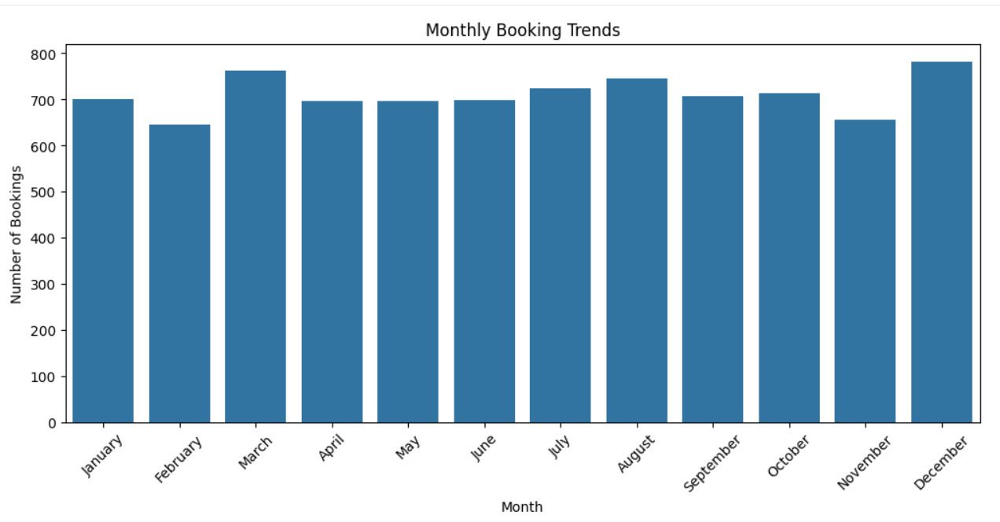

**Insight:** December records the highest booking volume in the displayed monthly comparison, while February and November show relatively lower volumes.

### 5. Booking Status Distribution

Analyzed the distribution of confirmed, cancelled, and completed bookings.

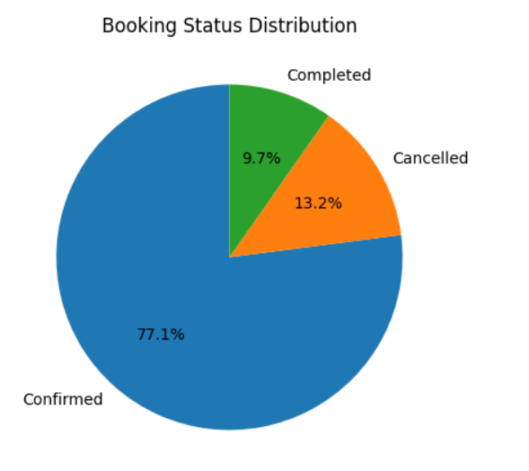

**Insight:**
- Confirmed: 77.1%
- Cancelled: 13.2%
- Completed: 9.7%

Confirmed bookings represent the largest share of recorded bookings.

### 6. Revenue by Property Type

Compared total booking revenue across accommodation types.

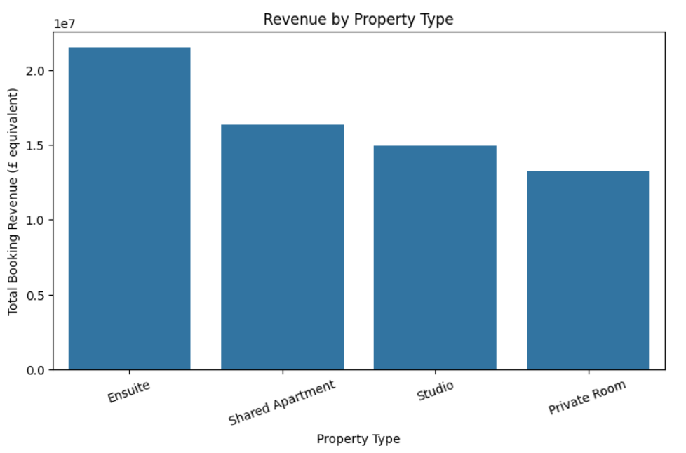

**Insight:** Ensuite accommodation generates the highest total booking revenue among the property types analyzed.

### 7. Booking Revenue by Destination Country

Analyzed revenue generated across different destination countries.

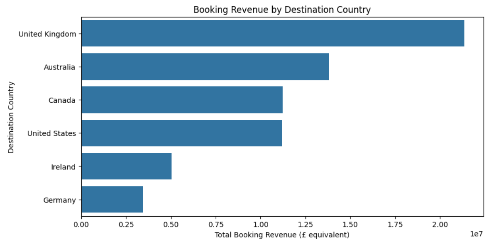

**Insight:** The United Kingdom contributes the highest booking revenue, followed by Australia.

### 8. Cancellations by Property Type

Examined the number of cancelled bookings across accommodation types.

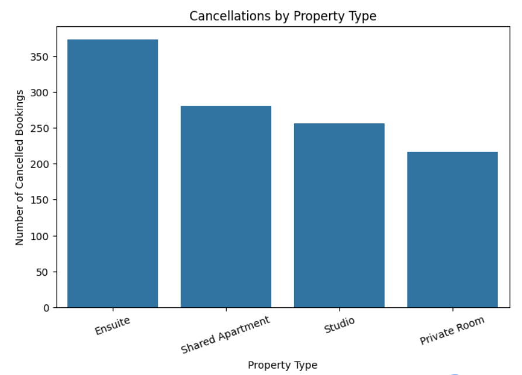

**Insight:** Ensuite accommodation has the highest cancellation count. Further investigation of cancellation rates is required to compare property types fairly.

### 9. Payment Status Distribution

Analyzed payment records based on their transaction status.

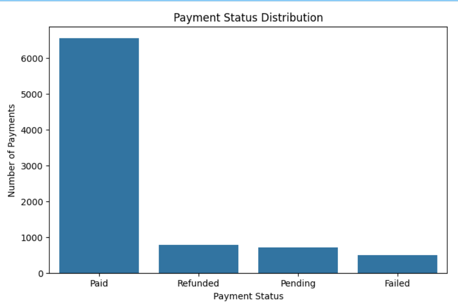

**Insight:** Paid transactions represent the largest share of payment records, while refunded, pending, and failed transactions represent smaller portions.

### 10. Student Review Ratings

Analyzed student satisfaction through review ratings.

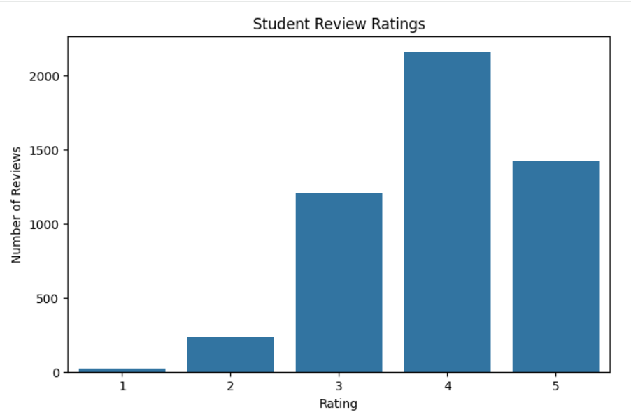

**Insight:** Rating 4 is the most frequently recorded rating, followed by rating 5, indicating generally positive student feedback.

### 11. Monthly Booking Revenue Trend

Analyzed monthly booking revenue to understand financial performance over time.

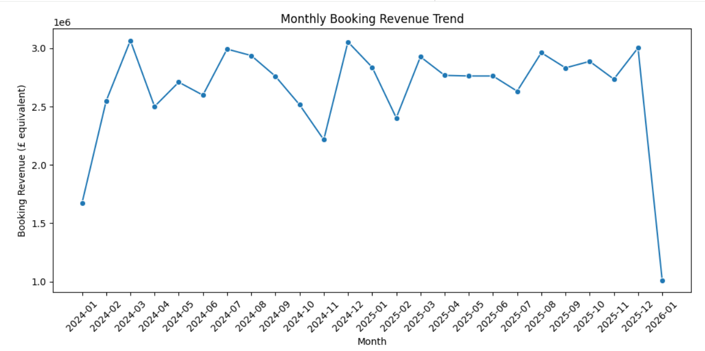

**Insight:** Booking revenue fluctuates throughout the year. The sharp decline in January 2026 should be investigated to determine whether it reflects an incomplete reporting period.

---

## 📈 Key Business Metrics

The project calculates the following business metrics:

| KPI | Description |
|---|---|
| Total Enquiries | Total number of recorded student enquiries |
| Total Bookings | Total number of recorded bookings |
| Average Booking Value | Average value of booking records |
| Bookings-to-Enquiries Ratio | Ratio of total bookings to total enquiries |
| Booking Revenue | Total booking value |
| Cancellation Count | Number of cancelled bookings |
| Payment Distribution | Distribution of payment statuses |
| Student Satisfaction | Distribution of student review ratings |

**Bookings-to-Enquiries Ratio:**

Bookings-to-Enquiries Ratio = (Total Bookings / Total Enquiries) × 100

Note: This is a record-based ratio, not necessarily a true student conversion rate, because students may create multiple enquiries or bookings.

---

## 💡 Key Business Insights

Based on the exploratory data analysis:

1. **Student Acquisition:** India is the largest source of student enquiries, making it an important market for student acquisition strategies.
2. **Destination Demand:** The United Kingdom attracts the highest number of student preferences and generates the highest booking revenue.
3. **Accommodation Demand:** Ensuite properties have the highest booking volume and revenue contribution.
4. **Booking Performance:** Confirmed bookings account for 77.1% of recorded booking statuses.
5. **Cancellation Analysis:** Ensuite properties have the highest cancellation count and require further investigation.
6. **Payment Performance:** Paid transactions dominate the payment distribution.
7. **Customer Satisfaction:** Most students provide ratings of 4 or 5.
8. **Revenue Trends:** Monthly booking revenue fluctuates, highlighting the importance of monitoring seasonal business performance.

## 🚀 Business Recommendations

- Focus marketing campaigns on high-enquiry student markets.
- Strengthen accommodation availability in popular destinations.
- Optimize pricing and inventory for high-demand property types.
- Investigate cancellation reasons to reduce booking losses.
- Monitor pending and failed payments to improve payment success.
- Use student feedback to improve accommodation services.
- Analyze customer support tickets to identify recurring problems.
- Monitor monthly revenue and booking performance to identify seasonal trends.

## 📁 Project Structure

```text
Student-Accommodation-Analytics/
│
├── Student_Accommodation_Analytics.ipynb
│
├── students.csv
├── properties.csv
├── enquiries.csv
├── bookings.csv
├── payments.csv
├── reviews.csv
├── support_tickets.csv
│
├── images/
│   ├── student-enquiries-by-origin-country.png
│   ├── student-preferred-destinations.png
│   ├── bookings-by-property-type.png
│   ├── monthly-booking-trends.png
│   ├── booking-status-distribution.png
│   ├── revenue-by-property-type.png
│   ├── booking-revenue-by-destination-country.png
│   ├── cancellations-by-property-type.png
│   ├── payment-status-distribution.png
│   ├── student-review-ratings.png
│   └── monthly-booking-revenue-trend.png
│
└── README.md
```

## ▶️ How to Run the Project

**Step 1:** Clone this repository.

```bash
git clone YOUR_GITHUB_REPOSITORY_URL
```

**Step 2:** Install the required libraries.

```bash
pip install pandas numpy matplotlib seaborn jupyter
```

**Step 3:** Open the Jupyter Notebook.

```bash
jupyter notebook
```

**Step 4:** Open `Student_Accommodation_Analytics.ipynb`.

**Step 5:** Make sure all seven CSV files are available in the correct directory and execute the notebook cells.

Alternatively, upload the notebook and datasets to Google Colab.

---

## 🏁 Conclusion

This project demonstrates an end-to-end data analytics workflow using Python, Pandas, NumPy, Matplotlib, and Seaborn.

By analyzing seven interconnected datasets, I explored student accommodation demand, destination preferences, booking performance, revenue trends, payment outcomes, and customer satisfaction.

The analysis provides meaningful business insights that can help accommodation businesses improve marketing strategies, optimize property offerings, reduce cancellations, and enhance the overall student experience.

---

### 👨‍💻 Author

**Aspiring Data Analyst**

**Skills Demonstrated:** Python | SQL Concepts | Pandas | NumPy | Exploratory Data Analysis | Data Cleaning | Data Visualization | Business Analytics

**Project Domain:** Global Student Accommodation & Business Analytics
